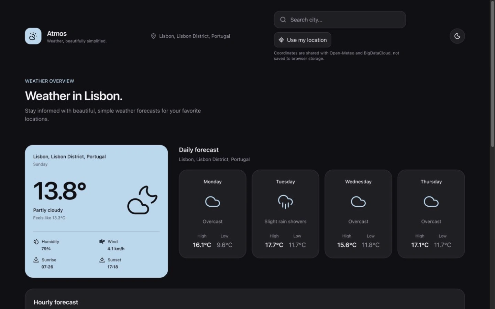
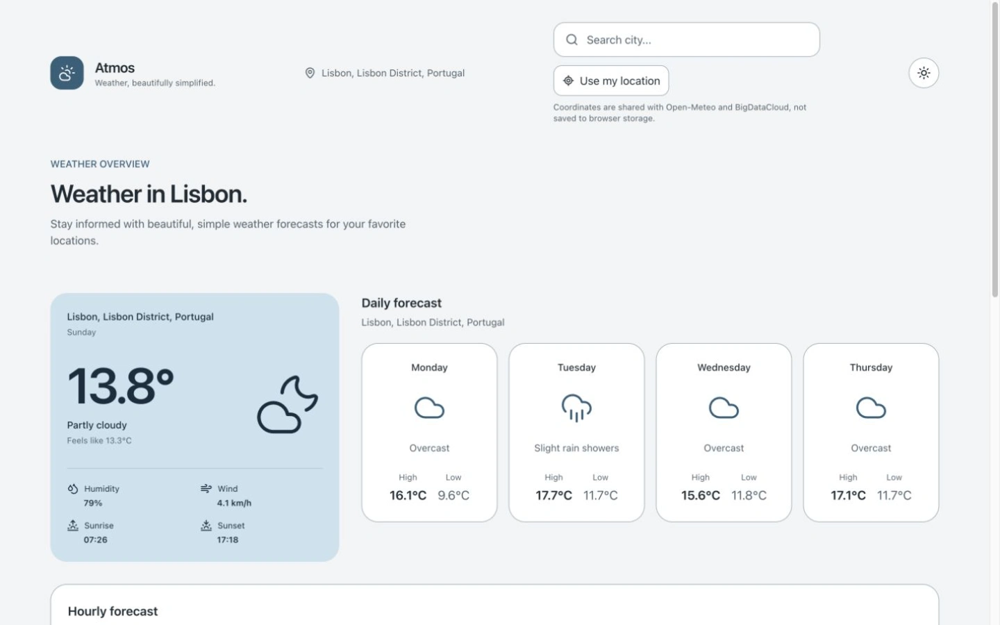
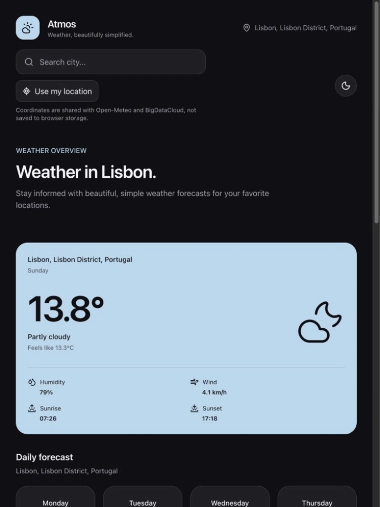
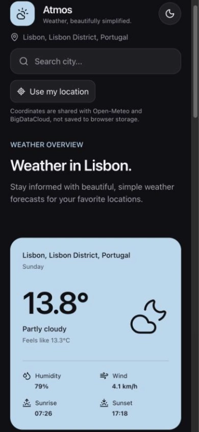

# Atmos Weather App

**Weather, beautifully simplified.**

A modern, responsive weather app built with React 19, featuring real-time forecasts, city search, device location and Dark/Soft Light themes.

**[Live Demo](https://atmos-by-arafam.vercel.app)**

## Application Preview

### Desktop





### Responsive Design

|                       Tablet                       |                       Mobile                       |
| :------------------------------------------------: | :------------------------------------------------: |
|  |  |

## Features

- **Live weather:** Current conditions, hourly forecasts and four-day predictions.
- **City search:** Search worldwide with autocomplete suggestions.
- **Geolocation:** Get local weather with permission-based GPS.
- **Dark & Light themes:** Persistent theme preferences.
- **Responsive design:** Optimized for desktop, tablet and mobile.
- **Accessibility:** Keyboard navigation, semantic HTML and visible focus states.

## Tech Stack

- **Frontend:** React 19, JavaScript (JSX), Vite 8
- **Styling:** Tailwind CSS v4
- **State Management:** TanStack Query v5
- **APIs:** Open-Meteo, BigDataCloud
- **Icons:** Lucide React
- **Testing & CI/CD:** Node.js Test Runner, ESLint, GitHub Actions
- **Deployment:** Vercel

## Getting Started

```bash
git clone https://github.com/arafamdev/atmos-weather-app.git
cd atmos-weather-app
npm ci
npm run dev
```

Requires Node.js 24.

## Testing

```bash
npm test
npm run lint
npm run build
```

**212 automated tests passed**, plus 23 browser DOM checks using simulated interactions.

## Author

Developed by **Arafam Mussa Silla**.

[GitHub](https://github.com/arafamdev) · [LinkedIn](https://www.linkedin.com/in/arafam-mussa-silla-5a7866446/) · [Live Demo](https://atmos-by-arafam.vercel.app)

Weather data provided by [Open-Meteo](https://open-meteo.com/).
